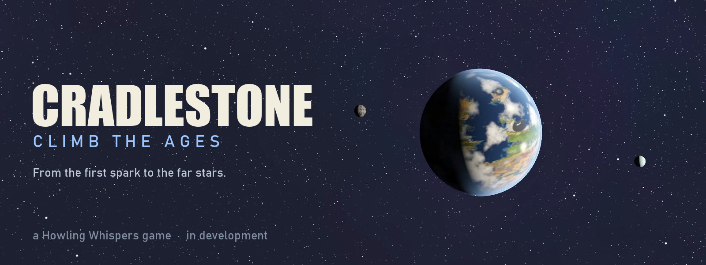

  🐺 <b>Howling Whispers</b> · independent studio · <a href="https://thehowlingwhispers.com">thehowlingwhispers.com</a>

  

  Wake on a pale blue pearl drifting in the dark. Make fire from stone, build a village, tame the wild, 
  and climb from the first spark to the far stars.

  
  

<table>
  <tr>
    <td width="33%" valign="top">
      <b>🌍 A real planet</b> 
      Plates, climate, rivers and volcanoes. Walk all the way round.
    </td>
    <td width="33%" valign="top">
      <b>🪨 Real-world crafting</b> 
      Dry sticks snap, reeds bend, clay must be fired.
    </td>
    <td width="33%" valign="top">
      <b>🐾 Coda at your side</b> 
      A malamute companion, 52 creatures, and dedicated servers.
    </td>
  </tr>
</table>

---

### More from Howling Whispers

<table>
  <tr>
    <td width="33%" valign="top">
      <b>🎵 Music &amp; videos</b> 
      Arrax Shadowfang and Mire's Sorod, with music videos made in Godot. 
      <a href="https://soundcloud.com/arrax-shadowfang">SoundCloud</a>
    </td>
    <td width="33%" valign="top">
      <b>🌲 Bitterroot</b> 
      A dark top-down tale of the Woods, plus the Saga books and story tapes. 
      <a href="https://github.com/HowlingWhispers/Bitterroot-Releases">Releases</a> · <a href="https://saga.thehowlingwhispers.com">The Saga</a>
    </td>
    <td width="33%" valign="top">
      <b>⛏️ Minecraft ecosystem</b> 
      A launcher, a mod loader built from scratch, and mods. 
      <a href="https://github.com/HowlingWhispers/HW-CodaLauncher">CodaLauncher</a> · <a href="https://github.com/HowlingWhispers/HW-CodaLoader">CodaLoader</a> · <a href="https://github.com/HowlingWhispers/HW-Mods">HW-Mods</a>
    </td>
  </tr>
</table>

A safer place to be you. 🐺

